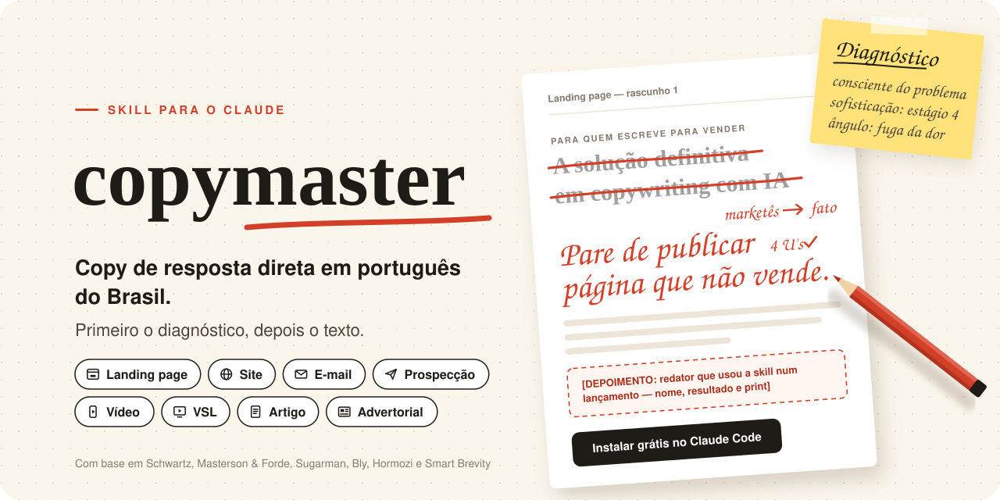
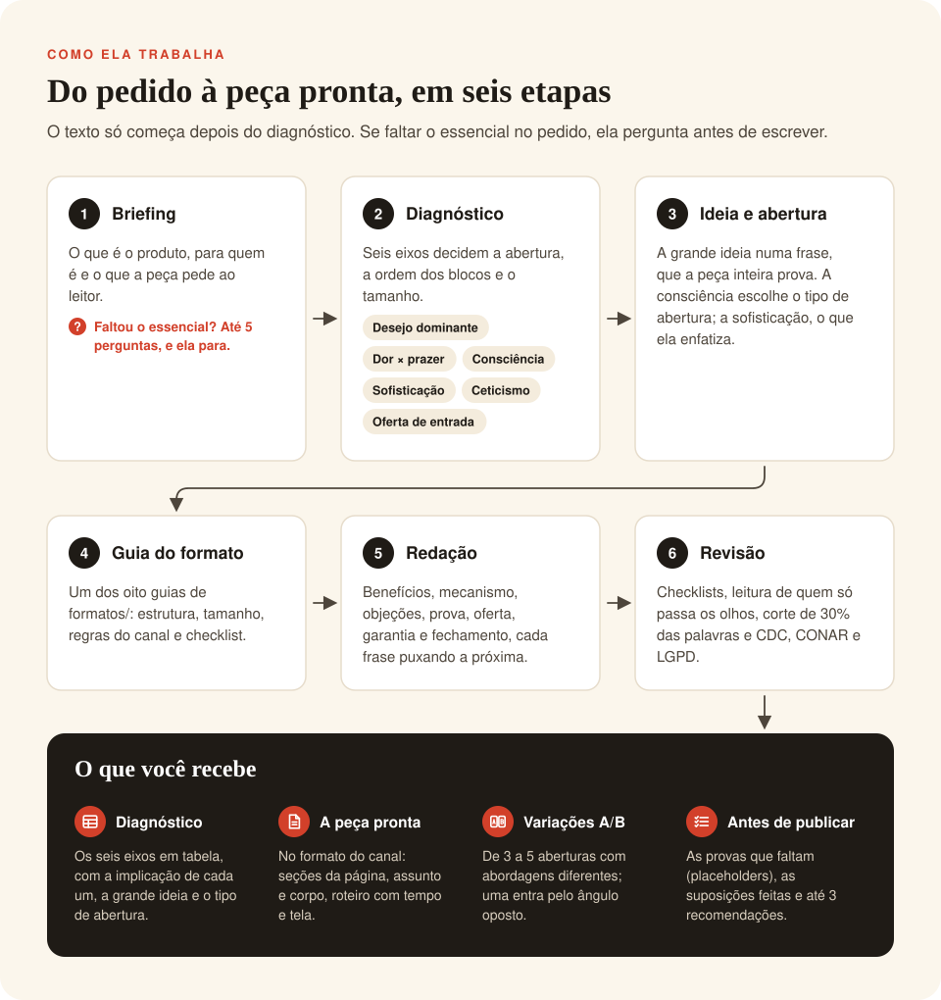
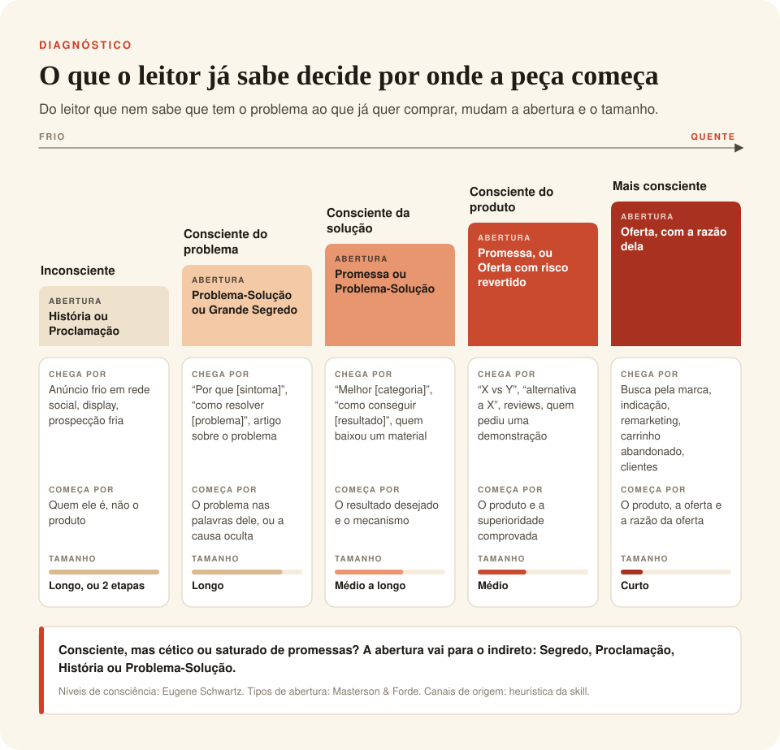
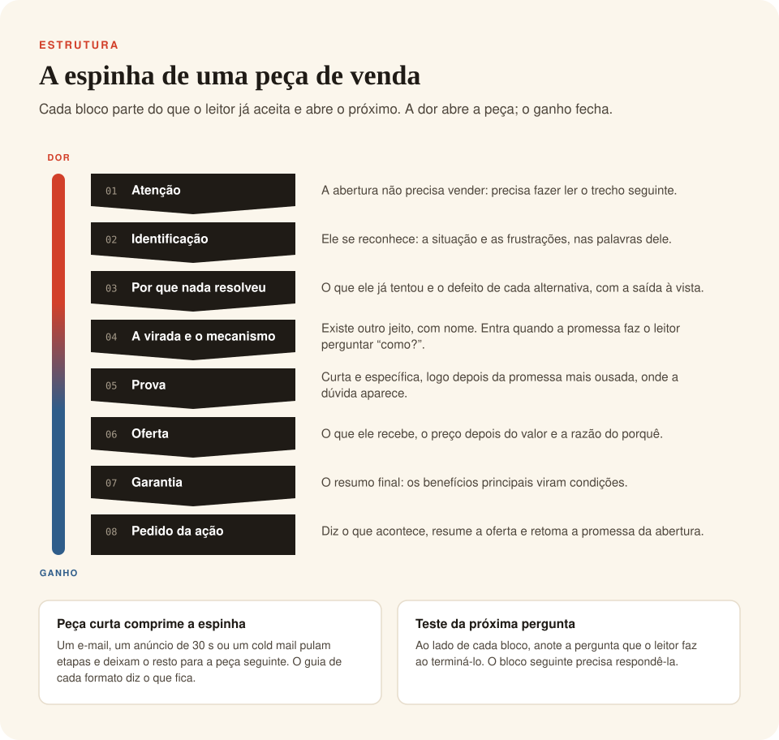
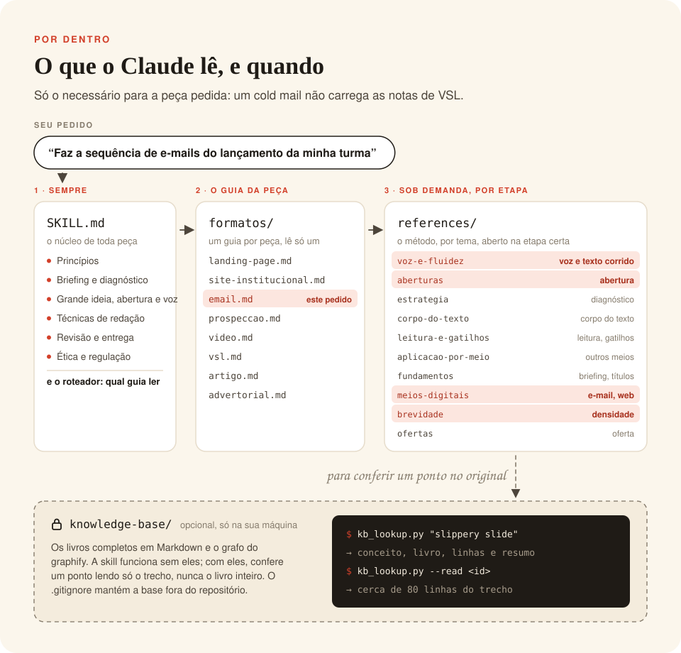

# copymaster

Skill para o Claude escrever **copy de resposta direta em português do Brasil**: landing pages, sites institucionais, e-mails, prospecção fria, roteiros de vídeo, VSL, artigos e advertoriais. Ela não sai escrevendo: primeiro diagnostica o público e o mercado, depois decide a abertura, a estrutura e a oferta, e só então redige, no formato do canal.

> *English summary:* a Claude skill that writes direct-response copy in Brazilian Portuguese for landing pages, websites, marketing and cold e-mail (plus LinkedIn and WhatsApp outreach), video ads, video sales letters, articles and advertorials. It runs a short strategic diagnosis (awareness level, market sophistication, pain × pleasure angle, skepticism, entry offer) before writing, based on direct-response classics (Eugene Schwartz, Masterson & Forde, Joseph Sugarman, Robert Bly, Alex Hormozi) and Axios' *Smart Brevity*. Each format has its own guide.

## Formatos

| Peça | Guia |
|---|---|
| Landing page, página de vendas, de captura e de obrigado | `formatos/landing-page.md` |
| Site institucional: home, serviços, produtos, "sobre", contato | `formatos/site-institucional.md` |
| E-mail de marketing e sequências (boas-vindas, nutrição, lançamento, carrinho, newsletter) | `formatos/email.md` |
| Prospecção fria: cold mail, LinkedIn e WhatsApp, com follow-ups | `formatos/prospeccao.md` |
| Roteiro de vídeo: anúncio, Reels, TikTok, Shorts, vídeo explicativo | `formatos/video.md` |
| VSL e webinar de vendas | `formatos/vsl.md` |
| Artigo de blog e de conteúdo, com foco em busca ou não | `formatos/artigo.md` |
| Advertorial e presell | `formatos/advertorial.md` |

Posts e legendas orgânicas de redes sociais ficam de fora: pedem outro método.

## Como ela trabalha



Antes de escrever, ela descobre o que o leitor já sabe. É isso que decide por onde a peça começa e quanto ela precisa dizer:



A maioria das peças de venda segue a mesma espinha. Cada formato estica ou comprime essa espinha, e o ângulo vai da dor, na abertura, ao ganho, no fechamento:



## O que ela entrega

Para cada pedido, uma resposta neste formato:

1. **Diagnóstico** em tabela: desejo dominante, ângulo (fuga da dor × busca do prazer), nível de consciência, sofisticação do mercado, ceticismo e oferta de entrada, cada um com a implicação para a peça.
2. **Grande ideia, tipo de abertura (lead) e estrutura** da peça.
3. **A peça pronta para colar**, no formato do canal: seções da página, assunto e corpo de cada e-mail, cadência de prospecção por canal, roteiro em tabela com tempo, fala e texto na tela, artigo com título e meta description.
4. **3 a 5 variações da abertura** para teste A/B (H1, assunto, gancho, título). Pelo menos uma usa o ângulo oposto, para você descobrir se o seu mercado responde mais à dor ou ao prazer.
5. **Antes de publicar:** placeholders a preencher, suposições feitas e até 3 recomendações.

Quando você cola um texto existente, ela também aponta o que está errado nele e explica o que mudou e por quê. Quando falta o essencial no pedido (o que é o produto, para quem é e o que a peça pede), ela faz no máximo 5 perguntas antes de escrever.

## Princípios que ela segue

- **Nunca inventa prova.** Depoimento, número, logo ou prêmio que não está no seu briefing vira um placeholder que diz exatamente o que buscar, por exemplo `[DEPOIMENTO: paciente com dor lombar há anos que voltou a correr — nome, idade, foto]`.
- **Escassez e urgência só se forem reais**, sempre com a razão dita na peça.
- **Setores regulados** (saúde, finanças, advocacia, suplementos): promete o processo e o cuidado, não o resultado garantido, e avisa quando uma frase precisa de revisão (CDC, CONAR, conselhos profissionais).
- **Regras do canal:** advertorial identificado como publicidade, prospecção com origem do contato e saída fácil (LGPD), anúncio sem afirmar condição pessoal do espectador (políticas das plataformas).
- **Sem marketês e sem enrolação:** troca "soluções completas" e "Em um mundo cada vez mais competitivo…" por fatos, números e cenas.

## Instalação

### Claude Code

Clone o repositório e copie a pasta da skill para as suas skills pessoais:

```bash
git clone https://github.com/RafaelFariaFerreira/copymaster.git
cp -r copymaster/copymaster ~/.claude/skills/
```

Se quiser receber as atualizações com um `git pull`, use um link simbólico em vez da cópia:

```bash
ln -s "$PWD/copymaster/copymaster" ~/.claude/skills/copymaster
```

Para usar só num projeto, coloque a pasta em `.claude/skills/copymaster/` dentro do projeto.

### Apps do Claude

Nos apps que aceitam skills personalizadas, compacte a pasta `copymaster/` em um `.zip` e envie pela área de skills das configurações.

### Base de conhecimento local (opcional)

A skill funciona sem ela: os arquivos de `references/` já trazem o método completo de cada livro. Se você tem os livros em Markdown, pode ligá-los à skill para ela conferir um ponto no trecho original:

```bash
ln -s "/caminho/da/sua/base" copymaster/knowledge-base
python3 copymaster/scripts/kb_lookup.py "slippery slide"
```

A pasta pode ter um `graphify-out/` (grafo gerado pelo [graphify](https://github.com/Graphify-Labs/graphify)); com ele, a busca encontra conceitos e devolve o livro e as linhas do trecho. Sem ele, use `--grep`. A base fica só na sua máquina: o `.gitignore` impede que ela vá para o repositório, e os livros não fazem parte deste projeto.

## Como usar

Não precisa chamar a skill pelo nome. Ela é acionada quando você pede um texto que precisa vender ou levar a uma ação, por exemplo:

- "Escreve a landing page da minha clínica, vou anunciar no Instagram"
- "Reescreve a home e as páginas de serviço do meu escritório"
- "Faz a sequência de e-mails do lançamento da minha turma"
- "Cria uma cadência de cold mail e WhatsApp pra prospectar clínicas"
- "Roteiro de Reels de 30 segundos pro meu anúncio"
- "Script de uma VSL de 15 minutos pra minha mentoria"
- "Artigo pro blog que apareça no Google e leve pra minha consultoria"
- "Advertorial pra rodar no Facebook antes da página de vendas"

Quanto mais o pedido disser sobre o produto, o público, o canal, a oferta e as provas que você tem (números, depoimentos, clientes), melhor fica a peça.

## Estrutura



```
copymaster/
├── SKILL.md              # núcleo: princípios, briefing, diagnóstico, abertura, técnicas, revisão, ética
├── formatos/             # um guia por peça: estrutura, regras do canal, entrega e checklist
│   ├── landing-page.md
│   ├── site-institucional.md
│   ├── email.md
│   ├── prospeccao.md
│   ├── video.md
│   ├── vsl.md
│   ├── artigo.md
│   └── advertorial.md
├── references/           # o método, organizado por tema; lido sob demanda
│   ├── aberturas.md          # os 6 tipos de abertura, a Regra do Um, o lead em cada formato
│   ├── estrategia.md         # desejo, consciência, sofisticação, ponto de entrada, verbalização
│   ├── corpo-do-texto.md     # crença, benefícios, mecanismo, objeções, prova, camuflagem
│   ├── leitura-e-gatilhos.md # escorregador, sementes de curiosidade, os 31 gatilhos, fechamento
│   ├── aplicacao-por-meio.md # voz, objeções, prova e adaptação a outros meios
│   ├── fundamentos.md        # briefing, comprador, argumento, títulos e 4 U's, carta, oferta
│   ├── meios-digitais.md     # site, SEO, landing page, e-mail, anúncios online, vídeo, conteúdo
│   ├── brevidade.md          # texto enxuto e escaneável, palavras fortes em português
│   └── ofertas.md            # oferta premium, grátis ou com desconto; atrito
├── scripts/kb_lookup.py  # busca na base de conhecimento local (opcional)
└── evals/                # casos de teste (formato do `claude plugin eval`)
```

O `SKILL.md` diz o que fazer em cada etapa e qual arquivo ler. O modelo só abre o guia do formato pedido e as referências de que precisa, então um cold mail não carrega as notas de VSL.

As ilustrações deste README ficam em `docs/` e saem do script `docs/gerar_imagens.py` (`pip install fonttools brotli`, depois `python3 docs/gerar_imagens.py`). Elas usam as fontes Fraunces, Inter, Caveat e JetBrains Mono, todas sob a SIL Open Font License, embutidas em cada SVG.

## Testes

A pasta `evals/` tem 11 casos realistas, cada um com critérios verificáveis:

| Caso | O que testa |
|---|---|
| `briefing-insuficiente-pergunta` | Pedido vago: a skill pergunta antes de escrever, em vez de inventar |
| `fisioterapia-trafego-frio` | Landing page de saúde para público frio: abertura pelo problema, razão da avaliação grátis, sem promessa de cura |
| `reescrever-home-contabilidade` | Reescrita de uma home cheia de marketês, usando as provas reais do briefing com as ressalvas |
| `saas-estoque-busca-google` | Landing page de SaaS B2B com tráfego de busca: comparação, "como funciona", preço ancorado |
| `email-sequencia-lancamento` | Sequência de lançamento para lista própria: calendário, assunto e pré-cabeçalho, urgência pelo prazo real |
| `prospeccao-b2b-clinicas` | Cadência de cold mail, LinkedIn e WhatsApp: relevância, pedido pequeno, follow-ups com ângulo novo, saída fácil |
| `video-anuncio-reels-fisioterapia` | Anúncio de 30 s: gancho nos 3 primeiros segundos, dor impessoal, texto na tela, CTA |
| `vsl-mentoria-psicologos` | VSL de 12–15 min: promessa cedo, oferta antes do preço, sem promessa vedada pelo CFP |
| `artigo-blog-sair-do-mei` | Artigo de busca: resposta no início, subtítulos que afirmam, CTA discreto, ressalva de valores que mudam |
| `advertorial-travesseiro` | Advertorial: identificação de publicidade, título editorial, sem imitar veículo real, sem promessa de cura |
| `site-institucional-advocacia` | Site de escritório de advocacia: mapa do site, uma página por área, regras de publicidade da OAB |

Com o Claude Code, dá para rodar os mesmos testes de dentro da pasta da skill. Eles comparam a resposta com a skill e sem ela. São execuções reais do modelo e contam no seu uso:

```bash
cd copymaster
claude plugin eval . --allow-tools Write,Edit,Bash
```

### Última avaliação

A última rodada medida cobriu só as landing pages (3 casos, 1 execução por configuração), ainda com o nome anterior da skill: as respostas **com a skill** cumpriram **94%** dos critérios, contra **55%** **sem a skill**. Os formatos novos ainda não foram medidos.

## De onde vem o método

Os arquivos de `references/` transformam o método de cada livro em instruções para o agente, escritas do zero em português: não reproduzem trechos dos livros nem os exemplos deles (anúncios, headlines, casos), e os exemplos que aparecem foram criados para a skill e vêm marcados como ilustrativos. Os guias em `formatos/` aplicam esse método a cada peça. O que os livros não cobrem (detalhes atuais de LinkedIn, WhatsApp e vídeo curto) vem marcado como prática de mercado. Nada disso substitui os livros, e este projeto não tem relação com os autores nem com as editoras. Se a skill for útil para você, leia os originais:

- Eugene M. Schwartz, *Breakthrough Advertising* (1966): desejo de massa, níveis de consciência, sofisticação de mercado.
- Michael Masterson e John Forde, *Great Leads: The Six Easiest Ways to Start Any Sales Message* (2011): os seis tipos de lead e a Regra do Um.
- Joseph Sugarman, *The Adweek Copywriting Handbook* (2007): o escorregador de leitura, as sementes de curiosidade e os gatilhos psicológicos.
- Robert W. Bly, *The Copywriter's Handbook* (4ª edição, 2020): checklists de redação, a sequência de venda e o copy para web, e-mail, vídeo e B2B.
- Alex Hormozi, capítulos bônus de *$100M Leads* (2023): ofertas grátis, com desconto e premium; atrito.
- Jim VandeHei, Mike Allen e Roy Schwartz, *Smart Brevity: The Power of Saying More with Less* (2022): texto curto, escaneável e direto.

## Limitações

- Escreve só em português do Brasil, mesmo quando o briefing vem em outra língua.
- Não substitui a revisão jurídica ou do conselho profissional em setores regulados, nem a leitura das políticas atuais de cada plataforma; ela só sinaliza o que precisa de revisão.
- A qualidade da peça depende do que você conta no briefing: sem provas reais, ela sai com placeholders no lugar delas.

## Licença

[MIT](LICENSE). Ela cobre o texto e o código deste repositório. Os livros citados não fazem parte do projeto e continuam com os seus autores e editoras.
